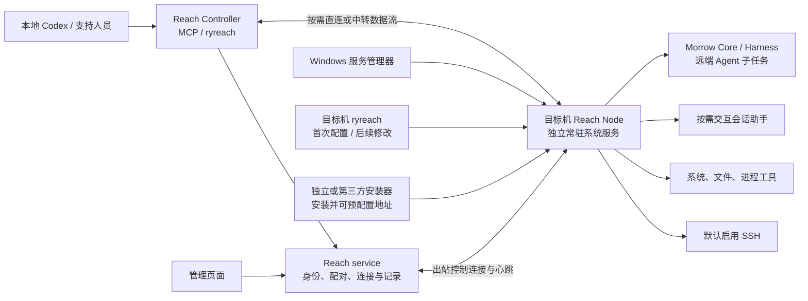
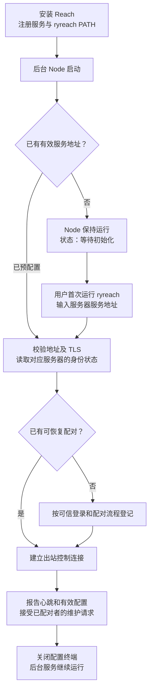

# Reach 首版架构

作者：Ray Zhang（Ray）。命名空间：RY。

日期：2026-11-02；更新：2026-11-14（Asia/Taipei）。已补充常驻与 Starferry 修复实现，实际验收以任务清单和本轮证据为准（0/52、0/5）。

## 2026-11-14 连接修复补充

双端 UDP 连接由 Controller 发起 HELLO，Node 接受该路径并返回 HELLO_ACK，Controller 收到 ACK 后再固定对端。Node 主动 HELLO 用于触发探测。多网卡候选需要双方确认同一路径，首个认证包的来源不足以确定数据路径。相关回归和原始失败见[独立复验案例](evidence/independent-validation-20261114.md#修复与复测2026-11-14)。

两端默认依次查询 `stun.cloudflare.com:3478`、`stun.l.google.com:19302`，第一个成功后停止。查询复用数据传输 UDP socket，每个服务器的 DNS 和收包合计限时 500ms；校验来源、transaction ID、magic cookie 与长度。`REACH_STUN_SERVER` 可指定 `host:port` 或 `stun:host:port`，显式空值关闭公网候选。STUN 不可达时继续使用本机候选和中转，公网双 NAT 成功率尚待实测。

待上传收据的暂态失败复用常驻连接的有上限指数退避函数，发布 `offline_backoff` 状态，收到 ACK 后恢复连接状态。上传任务继续存活，现有 Agent 执行与原账本收尾合同仍有效；永久认证错误交宿主处理。原操作效果和收据分别恢复，重传收据不触发动作重放。

用户在早期会话要求按 52 项任务清单实现首版并部署到 Ray 工作台；2026-11-13 补充确定 **Starferry 合并、默认启用 SSH、独立常驻服务、首次 `ryreach` 地址配置、分钟级可远程调整心跳与断网退避**，并明确 **QSpin 仅负责安装时默认安装 Reach 和配置服务器地址，具体接线归 QSpin 处理，不建设 QSpin 运行时集成**。产品目标与 REQ-01–REQ-06 沿用 [product-scope.md](product-scope.md)。

2026-11-24 修订了下一版的安装与站点装配要求。默认 Windows 包必装 Worker 和 Agent，离线 OpenSSH 随包按需启用，nmrkit 选装 Reach Desk。本文的默认 SSH 流程记录上一版设计及当前安装行为，新要求见 [11 月 24 日产品决定](knowledge/product-decisions.md#worker-agent-desk-20261124)。

## 组成

| 组件 | 实现选择 | 职责与部署 |
|---|---|---|
| service | TypeScript、Node.js 24、node:sqlite | 一个组织服务进程；账户、配对、设备连接、操作投递、事件索引、产品配置和管理 API |
| node | 独立 Rust workspace，命令 reach | Windows 系统服务、现场工具、实际操作账本、持久结果上传；远端 Agent 经原 Lite/Harness 调用 |
| controller | TypeScript CLI/MCP 适配；发行时打包所需运行时 | 开发机登录、目标选择、工具调用、状态及证据读取；对本地 Codex 提供 MCP Server |
| admin | 浏览器管理页面，由 Reach 服务提供 | 设备、配对、连接和运行记录；独立部署支持自身登录，Ray 部署复用平台浏览器登录，LabSlot 集成延期 |
| desktop helper | 交互用户会话中的开源 MCP 后端及受控接线 | 读取真实桌面、截图、键鼠或控件操作；不在 Windows Session 0 中假定用户桌面可用 |

四个源码目录是职责边界。现场用户只需安装发行包，不要求自行安装 Node、Rust 或 Python。现场 pair/status/unpair 命令由 Rust reach.exe 提供；开发机控制器发行命令须避免覆盖现场命令。

用户新增的 Reach Desk 云端对话作为独立选装组件，不改变以上基础安装。扩展拥有聊天界面、消息历史和云端 Host，复用 Reach 身份、设备查询、操作及委托合同。基础发行无聊天依赖；Ray 可装配扩展。源码位于 platform/；最终接线与运行方式仍在实施，实际实现和迁移条件见[云端平台扩展设计](platform-extension.md)。

## 调用关系

本地 Codex → controller MCP → Reach service → Node → 系统/桌面/产品工具。

远端委托沿同一条连接到达 Node，由 Node 组装 Lite Harness Host。模型入口和凭据由组织管理，Core 不拥有 Reach 账户或设备表。直接工具调用不经过模型。

选装后的另一路入口为：浏览器对话 → Reach Desk 云端 Host → 原 Lite/Harness。纯对话不要求设备；设备工具或远端子任务通过 Reach service 到指定 Node，沿用同一操作账本和证据查询。云端 Host 与 Node Host 复用循环实现，各自拥有明确的 Session/Run，不复制循环或让两个 Host 同时推进同一 Run。

Node 主动发起 HTTPS 请求，首个实现使用一秒短轮询，后续可改为有界长轮询；两种方式沿用同一收据合同。操作执行、取消查询、结果上传分别推进，长命令不能阻塞取消。领取响应丢失后仅查询原操作，不能领取同一操作作为新工作。

## 数据归属

| 数据 | 权威持有者 |
|---|---|
| 用户、会话、安装绑定、配对 epoch | Reach service |
| 控制端请求、投递状态、管理页事件索引 | Reach service |
| 已接收输入、执行前记录、文件/进程实际结果、结果 outbox | Node 本地持久账本 |
| 原生 Agent Session、Run 及 Harness 证据 | Lite/Harness；路径与业务映射由 Reach Node Host 管理 |
| 现场截图、输出文件、日志片段 | Node 产物及内容哈希；服务保存索引和已上传副本 |
| 产品业务数据、机器资产主数据 | 来源产品；Reach 保存来源 ID、版本和必要快照 |

服务数据库采用 WAL、synchronous=FULL。配对消费、领取和事件落账使用不跨 await 的事务，提交后应答。业务操作 ID、Node ID、配对 epoch 和规范输入哈希共同绑定一次执行。Node 必须先持久入场、再执行，单实例执行锁防止两个进程重复入场。

数据库初始化与升级需要检查 schema 版本；后续版本以显式迁移推进，不将未知新版本改回旧版本。备份需使用 SQLite 一致性备份，不能在进程运行时只复制主文件而漏掉 WAL。

## Windows 进程与状态

安装身份和账本统一放在受保护的 ProgramData/RY/Reach。服务账户拥有写权限；安装时确定的绑定用户通过经过认证的本机 IPC 调用 pair/status，解绑流程继续按配对合同实现，不各建一套 AppData 身份。安装器负责 ACL，并测试普通本机用户不能直接读安装凭据。

桌面助手绑定明确的 Windows session。退出登录、锁屏、UAC 安全桌面和会话替换均作为实际能力状态反馈；正在执行的未知操作不能换到另一个用户会话重做。

已实现的生产候选按绑定 SID 选择唯一 WTSActive 会话，绑定 Session ID、用户 SID、AuthenticationId 与 logon SID。暂停创建 helper，先纳入 Job 再恢复；外部认证管道由 supervisor 持有，worker 的 PID 只用于结果记录。helper 通过 SCM 状态/账户/PID 识别服务，Node 通过持有的创建进程句柄验证 helper；服务运行中再次检查 WTS 的原 logon 身份。可写 spool 与安装账本分离。普通用户管道链路已有实测，生产 SCM/WTS 权限及会话切换仍待实际安装验证，见[管道候选](evidence/desktop-pipe-20261102.md)。

服务启动选择为 Windows 自动延迟启动；桌面助手在用户登录时按会话启动。这是本次实现选择，需 I06/V03 实测后才能声称支持。

## 部署

2026-11-02 已部署：Reach 使用 Node v24.20.0、独立 systemd 单元及环回端口 18910，持久数据和配置独立保存。ray-front 在现有 443 下提供 `/reach/`，并增加工作台卡片；原 8443 入口已停用。

工作台源码固定于旧 Go 仓库 `llm-im.git` 的 `0b9cb7c`，与当前 Morrow Agent 父仓独立维护。浏览器先由 Ray 验证平台会话，再通过专用密钥签名换取绑定该会话的 Reach Cookie；每次浏览器 API 访问均复核绑定。原生控制器和 Node 保留独立认证。来源、同源信任边界与会话合同见[系统集成](integrations.md)，发布和恢复见[部署说明](deployment-ray.md)。

## 当前实现边界

TypeScript 服务、独立 Rust 前台 Node、CLI/MCP 控制器已实现首批工具链路。真实进程测试覆盖命令、文件、取消、重启和原回执恢复；管理页已有真实浏览器记录。另有 Linux 控制器经公网 443 调用 Windows Node 的文件效果、运行中事件、重复请求与原回执查询证据。Ray 登录后直接进入及多标签写请求已在部署版本验证。Windows 服务入口与本机 IPC 已实现，普通 host 验证另记证据；正式 SCM/SYSTEM、安装包、完整证据能力、真实桌面、模型委托和实际 Codex MCP 加载仍未验收。安装与更新边界见[安装合同](installation-update.md)。

## 2026-11-13 常驻服务与 Starferry 合并架构草案（待实施）

以下章节记录 2026-11-13 新增常驻与 Starferry 合并设计（关联 [REQ-01–REQ-06](product-scope.md#2026-11-13-新增需求与验收条件) 与 [工作流程图](starferry-reach-workflows.md)），用于指导后续 D01–D05、C03–C07 与 I01–I06 演进；原设计的实现与后续修复已记录于本页开头和[独立复验案例](evidence/independent-validation-20261114.md#修复与复测2026-11-14)，D01 及正式安装、网络验收仍待完成。

### 常驻组件与生命周期归属

| 组件 | 常驻阶段补充责任 | 明确不承担的责任 |
|---|---|---|
| Node | 独立常驻系统服务、目标服务地址与有效配置、持久配对凭据、连接/心跳状态、本地操作收据及受管 SSH 授权 | 不持有 QSpin/LabSlot 私有业务状态，不绑定产品进程生命周期 |
| service | 可信主体、配对关系、最近心跳、连接路由、远程配置请求/生效版本回执及操作/证据索引 | 不因消息送达或配置下发就宣布现场动作或配置已生效 |
| controller / `ryreach` | 本地目标选择、调用、状态/证据查询，以及目标机同一配置边界下的首次地址初始化、后续配置修改和配对 | 不因客户端退出销毁 Node 安装身份，不直接与运行服务竞争写配置文件 |
| 安装/升级组件 | 安装文件、服务注册、`ryreach` PATH、默认 SSH 准备和兼容升级；支持第三方安装器预置服务地址 | 不删除其他软件或用户的 SSH 授权；QSpin 安装器具体接线归 QSpin |

### 安装与首次启动（`ryreach` 初始化）

系统服务绝不从 stdin 读取地址。未配置时保持运行并报告 `等待初始化`；首次交互输入由 `ryreach` 承担，外部安装器已预配置有效地址时不再重复询问。地址不是配对凭据，更换服务器地址属于信任边界变化，不得将旧服务器登录令牌或绑定凭据发送到新地址。

### 连接、分钟级心跳与断网退避

长期出站控制连接承担即时请求、取消、配置下发与状态返回；分钟级心跳承担最近可达时间、版本、运行状态及有效配置版本报告；SSH 或文件等数据流按需尝试 Starferry 的 UDP 直连与中转回退。三者职责分开，即时操作不等待下一轮心跳。

| Node 状态 | 可观察行为 |
|---|---|
| 等待初始化 | 服务运行但未配置有效地址，不宣称在线，不反复请求空地址 |
| 等待配对 | 地址有效但缺少可信绑定；可以完成配对，不接受未配对控制调用 |
| 连接中 | 对当前服务器进行有界连接及身份校验 |
| 已连接 | 控制连接可用，按有效间隔发送心跳，按操作合同执行请求 |
| 离线退避 | 服务保持运行，单一重连调度器按退避等待；管理端显示最近成功时间 |
| 认证/配置错误 | 报告明确原因及恢复条件；不把被撤销配对或 TLS 错误当普通断网掩盖 |

建议默认心跳 60 秒（支持经已认证控制连接远程调整并按请求 ID / 目标版本 / 生效版本核验回执）；离线重试建议初始 5 秒、指数退避、上限 5 分钟并带随机抖动（`min(cap, base * 2^n * jitter)`），仅保留单一重连调度器且绝不自动重放未知效果操作。具体参数范围由 D03/D05 固定。

### 默认 SSH、Starferry 复用与外部安装边界

- **默认 SSH（REQ-02）**：默认准备并维持目标机可用 SSH 服务，复用已有 OpenSSH 配置、主机密钥与其他授权；缺失时按受控安装流程补齐。仅管理 Reach 创建的配对授权记录，不使用共享万能私钥，解绑/卸载只撤销受管授权。
- **Starferry 合并（REQ-01）**：复用原 ARA 仓库 `tools/ssh-tunnel/` 的 ICE/STUN、UDP 直连、云端中转、目标密钥校验及“已尝试流失败不自动重放、仅后续新流回退”行为；将一次性会话改造对齐到 Reach 持久安装身份与操作收据。
- **外部安装与 QSpin 边界（REQ-06）**：第三方软件通过通用安装入口安装 Reach 并预配置服务地址，Reach 独立常驻运行、不随产品启动或退出。QSpin 默认安装 Reach、配置服务器地址及显示安装结果的接线归 QSpin 项目；Reach 不修改 QSpin 安装器，也不设计 QSpin 网关、IPC、产品托管子进程或进程内方案。
