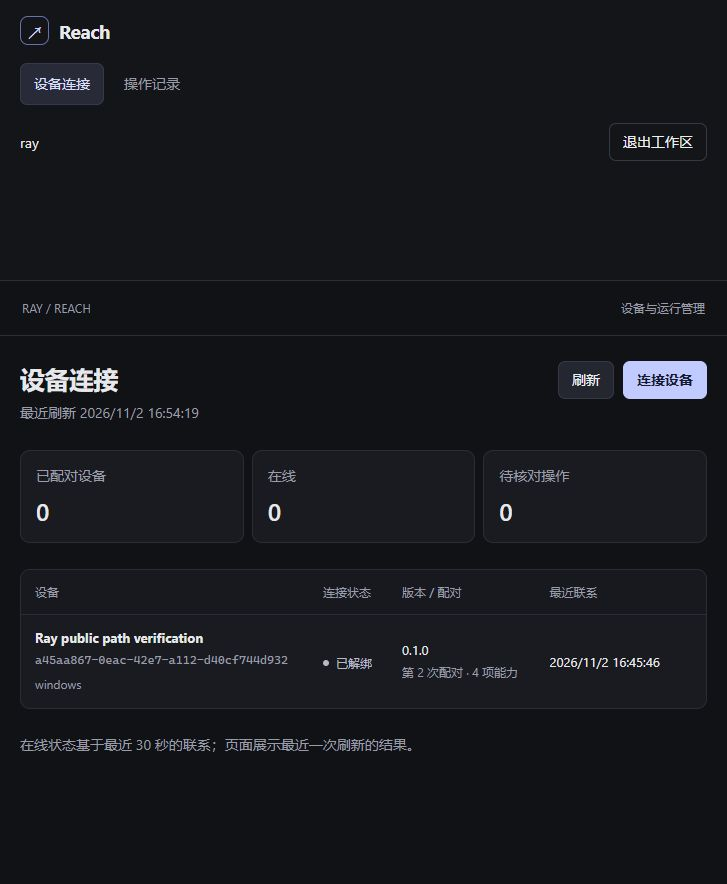

# Ray 登录后直接进入 Reach

作者：Ray Zhang（Ray）。日期：2026-11-02。来源：用户要求“Ray平台登录后，不用再次登录reach了”。本交付点已上线，覆盖 Ray 浏览器身份桥接、免二次登录、并发首登复用及现有原生链路回归；A04–A06 的完整前置能力和全清单验收仍开放。

## 当前发布与实现

当前入口为 `https://118.25.103.226/reach/`。Ray 先校验真实平台会话，经专用密钥签名交换建立 Reach Cookie；每次浏览器 API 请求复核 Ray 会话及绑定，验证声明不能创建会话。SSO token 不能改作原生 Bearer。原生控制器、Node 凭据与操作账本独立保留。完整合同见[系统集成](../integrations.md)。

首次 SSO 的 [snapshot.json](ray-sso-20261102/snapshot.json)包含 13 项 ARA 输入、9 项旧 Go 输入和 3 项产物。[stable-snapshot.json](ray-sso-20261102/stable-snapshot.json)覆盖最终 5 个输入及 3 个产物，替代父快照中同路径项；其余输入沿用父快照。旧 Go 基线为 `0b9cb7c3eabf1e4d82bfc1d6147786c2d883721c`，ARA 基线为 `90f2b1cdd138129e2d331d89a37d70852e849739`，均加本任务未提交 WIP。

第一次发布的[部署收据](ray-sso-20261102/deployment-receipt.json)记录独立密钥创建及 SSO 接线。最后一次更新只切 Reach 应用；[稳定会话部署收据](ray-sso-20261102/stable-deployment-receipt.json)记录：

- current：`/opt/reach/releases/20261102-sso-stable-05d25e8c84eb`。
- 归档 SHA-256：`05d25e8c84eb3ebf5dafe856deedd9de41cf651a58d2961aa9146def3991d1cf`。
- Go 二进制保持 `3b21deba87a5df87b19942a7b9557ab842ff92147e5103125d1d4a2b45fe7bd9`。
- 更新前后 Node/operation/event 均为 1/2/10；未恢复数据库。仅失效侧库标记的旧 SSO 会话，Ray 登录、原生会话和密钥保留。
- 更新后主代理实查 Reach 与 Ray 均 active，旧 8443 单元 disabled，current 与 Go SHA 符合收据。

稳定会话修正处理两个首次页面同时不带 Reach Cookie 的情况：以专用密钥、固定账户和 Ray session hash 派生同一 token，复用已有效的主库 session 和 CSRF；侧库 bind 使用 UPSERT，使注销、过期及跨库中途失败后仍可恢复。两库不是联合事务，失败仍拒绝进入。

## 源码检查与执行证据

| 范围 | 结果与原始日志 |
|---|---|
| 最终 TS 服务与 SSO 回归 | [17/17，0 skip，23.7807261 秒](ray-sso-20261102/service-tests-stable-session.txt) |
| 最终聚焦 SSO HTTP/SQLite | [2/2，0 skip，1.0759831 秒](ray-sso-20261102/stable-session-concurrency.txt)；与上行重叠，不相加 |
| Go、vet、既有 JS、Linux 构建 | [最终日志](ray-sso-20261102/ray-front-build-final2.txt)；Go 17.174 秒通过、JS 26/26、普通产物完成 |
| 原生公网跨机回归 | [完整 JSON](ray-sso-20261102/public-cross-machine.json)，见下文 |
| 最新上线/浏览器观察 | [部署收据](ray-sso-20261102/stable-deployment-receipt.json)、[浏览器记录](ray-sso-20261102/browser-verification.json)、[页面截图](ray-sso-20261102/reach-sso-devices.png) |

聚焦测试使用真实 HTTP 服务和 SQLite，验证签名伪造、错误 audience/账户字段、nonce 重复及重启后重复拒绝、过期、Origin/CSRF、Cookie 与原生 Bearer 用途隔离。同一 Ray session 的并发首次换票得到相同 Cookie；已有页面在其他根页换票后用原 CSRF 创建配对码成功；validate 无 token/不同平台 session 均拒绝；注销后根页可恢复。Go 受控请求验证平台 logout 取消在途交换，不发新 Cookie；路径别名、代理头及原生分流边界在原测试文件中核对。

独立复核由已有 Codex 子代理 `/root/reach_plan_review` 完成。最终三个服务文件及测试无确认阻断缺陷；更新脚本补审检查固定前置条件、活动操作拒绝、仅 SSO 会话清理、失败恢复和健康检查。复核者重新计算 stable 快照 5/5 输入、3/3 产物，检查包内服务文件和管理页 JS 一致。主代理回查源码、测试日志、收据及上线页面；没有把复核报告当作生产执行证据。

收尾文档也经同一独立复核者核对原始 JSON 和截图。修正“开发版配对尚未实现”及“当前 443 主服务沿用历史 8443 隔离配置”两处残留后，最终无确认误述。生产退出、回滚实测和完整清单未验收的范围保持不变。

## 实际浏览器和原生回归

用户亲自完成 Ray 验证码登录。最终更新后主代理在现有浏览器执行：

1. 回到工作台，看到“RAY · 已验证”和 Reach 卡片，点击后直接进入设备页，账户为 ray；全过程没有填写 Reach 密码。
2. 刷新第二个 Reach 标签页，原标签不刷新，仍能生成新的十分钟配对码；代码未记录到证据或截图。
3. 查看两条既有成功记录，并打开 `2d50c6a2-ce42-4bba-9c8e-5f3cbe2ac214`，原请求、exitCode 0、五条回执和输出仍可读取，没有重执行。

首次 SSO 发布后，Linux 普通 controller CLI/MCP 经公网 443 再调用真实 Windows Node。operation 为 `2d50c6a2-ce42-4bba-9c8e-5f3cbe2ac214`，实际观察 running，重复请求保留同 operation，五页回执可续读，控制器重新加载后仍查到原结果。文件只追加一次，SHA-256 为 `ae40dd4ab01092f8e18670486e02deb1606b18c1734d0d29cce59e58a1484027`。同一 installationId/Node 保留，配对 epoch 1 → 2；试验完成后解绑、停止前台 runner。

最后稳定会话修正未改 Rust 或 controller；此次更新后只读回原 operation，不重复执行文件写入。公网原生回归属于首次 SSO 发布，不能表述为稳定修正后重新做了一次跨机写入。

## 明确未覆盖

- 未在生产页面点击“退出工作区”，保留用户当前 Ray 登录；退出、过期和在途取消的证据来自受控 Go/HTTP 测试。
- SSO 启用/更新脚本的失败恢复仅完成源码复核，未执行独立故障回滚。旧 443 迁移脚本的两项受控测试不能替代它。
- 原生 MCP 协议试验不是 Codex 实际加载验收。Windows 服务/IPC、安装包、桌面、完整工具/附件、Lite/Harness 委托及可选真实产品仍待完成。
- 同源其他应用脚本与 Reach 共享浏览器信任边界，Cookie Path 不是来源隔离。完整 52 项未逐项验收，维持 0/52。
- 未提交或推送。humanizer 在本会话检索未找到，文档由主代理人工审读。[文档检查](ray-sso-20261102/document-check.json)核对 Reach Markdown 的本地链接及图片，无缺失；`git diff --check` 通过。全仓 `python scripts/verify_bootstrap.py` 仍报告 Reach 之外的断链，不能报告为全仓检查通过。
