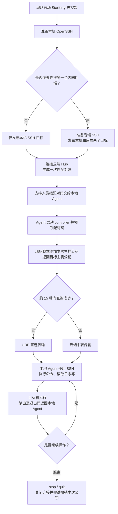
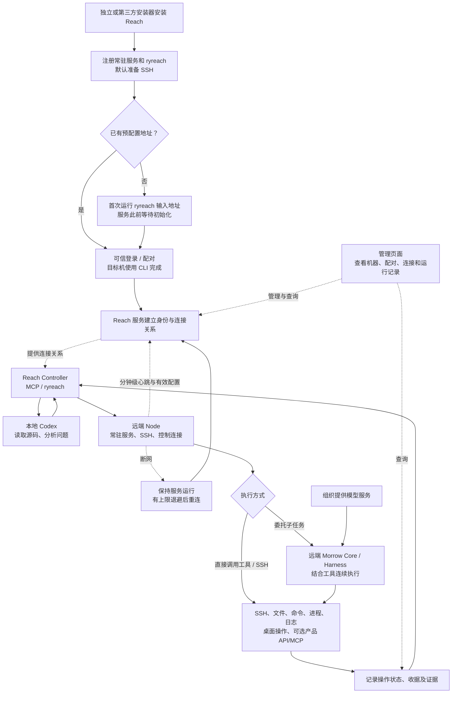
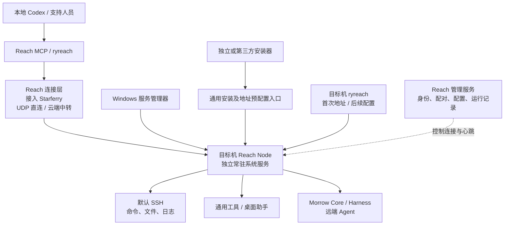

# Starferry 与 Reach 工作流程及合并计划

作者：Ray Zhang（Ray）。

日期：2026-11-13（Asia/Taipei）。来源基线：原 ARA 仓库 `dev`（`28ac6dcd73eebe07ca3b403b2e6fa26c8985a30e`），同日同步迁入 `ZZray/morrow-agent` 的 `apps/reach/`。

本文保存三张流程图，分别表示 Starferry 当前实现、Reach 常驻设计和合并后的独立安装结构。2026-11-13 用户已确定将 Starferry 功能接入 Reach、默认 SSH、后台常驻、`ryreach` 配置和分钟级心跳/断网退避；本轮只做计划。用户随后取消 QSpin 运行时集成，将默认安装 Reach 和配置地址交给 QSpin 项目。需求见[产品范围](product-scope.md)，设计细节见[架构](architecture.md)；Starferry 合并与 `ryreach` 常驻配置闭环尚未实施。

## 当前状态与区别

Starferry 在原 ARA 仓库 `tools/ssh-tunnel/` 已有 Go 隧道程序、Windows 脚本和 1.1.2 安装包；Reach 在 `apps/reach/` 已有首轮 HTTP/SQLite 服务、Rust Node/桌面宿主、CLI/MCP 控制器与可选 Reach Desk 本地分项代码，但 Starferry 连接合并、默认 SSH、`ryreach` 首次地址配置与分钟级远程可调心跳尚未接入，基础功能验收仍为 **0/52**（Reach Desk 选装为 **0/5**）。Reach 的持续验收状态以[任务清单](task-checklist.md)为准，Morrow 能力适配与常驻改造执行顺序见[任务执行单](tasks.md)。

| 对比 | Starferry 当前实现 | Reach 已有首轮基础 + 2026-11-13 常驻合并设计 |
|---|---|---|
| 主要用途 | 临时连上现场，通过 SSH 操作 | 管理远端机器，提供工具调用、SSH 访问及 Agent 子任务 |
| 谁分析任务 | 本地 Codex 等 Agent | 本地 Agent 主导，也能委托远端 Agent（Morrow Core / Harness） |
| 远端运行什么 | 隧道程序、OpenSSH、被执行的命令 | 独立常驻 Node 服务、默认 SSH、工具后端、桌面助手、可选 Agent |
| 连接生命周期 | 一次性支持会话，结束后重新配对 | 独立后台常驻，保留安装身份与配对，断网按退避规则重连 |
| 结果记录 | SSH 输出、退出码、会话及清理回执 | 结构化操作状态、持久账本收据和证据（未知效果不自动重放） |
| 网络连接 | UDP 打洞，失败后云端中转 | 计划接入 Starferry 直连/中转能力；分钟级心跳与即时控制连接分开 |
| 初始化和配置 | 每次支持由现场启动被控端 | 首次 `ryreach` 输入服务地址或接受安装器预配置，以后通过命令修改 |

## Starferry 当前工作流程

下图表示原仓库 `tools/ssh-tunnel/` 已实现的正常支持流程；具体网络和安装验收范围见原仓库历史交付记录 `docs/evidence/ssh-tunnel-20261102.md`。

被控端直接安装在 Server 目标机上时，只发布本机目标即可。当前脚本仍会询问是否准备 `192.168.3.199` 后端，输入 `S` 跳过；本机目标名 `jump` 在这种部署下指向该 Server 自身，不代表还要经过另一台机器。

Agent 的分析循环在本地，Starferry 负责连接，目标机通过 OpenSSH 执行命令。SSH/SCP/SFTP 等客户端可以使用主控生成的连接参数；真实文件工具流程的验收缺口仍以原交付记录为准。

直连成功后数据绕过 Hub，但云端控制连接必须保持。已经尝试的连接流失败时不自动重放，只允许后续新流回退中转。正常退出会尝试撤销本次公钥；强杀、断电或清理失败时，应核对现场回执，隧道退出不能作为公钥已撤销的证明。

## Reach 常驻与远端协作设计流程（待完整实现）

下图按[产品范围](product-scope.md)和[项目计划中的用户流程](project-plan.md#用户流程)整理。组件代表职责；远端 Agent 复用父仓 [Morrow Harness](../../../crates/morrow-agent-harness/README.md) 与 [JSONL 侧车](../../../crates/morrow-agent-jsonl/README.md)。

本地 Agent 可以逐次调用工具或 SSH，也可以提交目标，由远端复用 Morrow Core/Harness 连续执行子任务。远端 Agent 循环的位置与组织模型服务的位置分别描述；客户无需配置模型。管理页面用于管理及查询；选装 [Reach Desk](platform-extension.md) 时走同一套公共控制与收据边界，默认基础包不带云端聊天。

配对后采用已确定的完全控制行为，不增加权限模式或逐次操作审批。桌面能力需要接入交互用户会话，系统服务启动成功不能代表桌面已可操作。断线后查询原操作收据，效果未知的动作不自动重放。

Reach 的地址输入和持久身份初始化不等同于 Starferry 每次支持的“被控端出码、主控领取”。具体出码方向、再次配对和多控制端关系仍需 D03 固定；不能把两者画成已经共用同一身份体系。关闭配置终端不停止 Node；分钟级心跳报告状态，即时操作不必等待下一次心跳。

## 合并后的独立安装结构（待实现）

已确定以 Reach 承接 Starferry 功能。下图表示规划中的独立常驻形态，不表示连接层提取或接入已经完成。QSpin 将来由自己的安装器默认安装 Reach 并配置地址，图中外部安装器仅表示通用调用方，不设计 QSpin 具体接线。

| 可复用的基础 | 整合时需要设计或实现 |
|---|---|
| Starferry 的 ICE/STUN、直连和中转代码 | Reach 的工具请求、响应、SSH 与事件协议整合 |
| 连接关闭、流限制、未知动作不重放的处理 | 操作 ID、持久收据、断线后的结果查询对齐 |
| 现有 SSH 支持流程 | 常驻 Node 服务、受管 SSH 密钥归属、桌面助手与远端 Agent 接线 |
| 安装器和构建经验 | 独立常驻服务、首次 `ryreach` 配置、外部安装器预配置、升级及卸载归属 |

现有 Starferry 是 Go `package main` 程序（原 ARA 仓库 `tools/ssh-tunnel/`），目标合同限定 `jump` 和可选 `backend`，携带 SSH 用户与主机公钥。底层能够复制 TCP 字节，但尚未提供 Reach 的通用工具协议或可直接导入的连接 SDK。Reach 按 [REQ-02](product-scope.md#req-02) 默认准备 SSH 并复用已有 OpenSSH；连接层提取和缺失时安装方式由 D02/D05 确定，不能把现程序直接当作 SDK。

Starferry 的一次性支持会话与 Reach 保留的安装身份、配对关系及操作记录具有不同生命周期。常驻合并闭环目标为：默认 SSH、首次 `ryreach` 配置及配对、关闭终端仍可支持、可远程调整分钟级心跳、断网退避恢复，以及按原 ID 查询操作结果。该闭环尚未实施或验收。

## 来源与验证边界

| 依据 | 本文核对的内容 |
|---|---|
| 原 ARA 仓库 `tools/ssh-tunnel/README.md` | 安装角色、使用流程、直连和中转、会话边界 |
| 原 ARA 仓库 `tools/ssh-tunnel/scripts/windows/Start-Controlled.ps1` | 本机与可选后端准备、目标发布、公钥授权和清理 |
| 原 ARA 仓库 `tools/ssh-tunnel/controller.go`、`direct.go` | 领取配对、直连协商、本地监听、流回退与不重放 |
| 原 ARA 仓库 `tools/ssh-tunnel/hub.go`、`device.go`、`common.go` | 一次性配对、目标转发及 SSH 目标合同 |
| 原 ARA 仓库 `docs/evidence/ssh-tunnel-20261102.md` | 历史执行证据及未覆盖的现场、公网 NAT 和文件工具验收 |
| [Reach README](../README.md)、[源码目录说明](../src/README.md)、[任务清单](task-checklist.md) | 当前 Morrow 子项目实现边界、未完成项与功能验收 0/52（Desk 0/5） |
| [Reach 产品范围](product-scope.md)、[项目计划](project-plan.md)、[架构](architecture.md) | 已确定的产品要求、常驻架构草案和待实现流程 |

2026-11-13 的初始分析由独立 Codex reviewer `review_merge` 回源复核；随后常驻方案经 `reach_practical_plan`、`reach_maintenance_plan`、`reach_runtime_plan` 三个独立视角评审，并按用户取消 QSpin 运行时集成的最后指令收敛。同日迁入 `ZZray/morrow-agent` 时同步对齐 Morrow 包路径与既有实现说明。本次只更新计划与任务清单，未实施 Starferry 代码合并、安装或部署，不增加 Reach 的功能验收计数。
